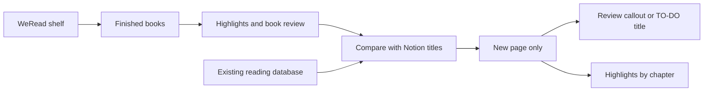

# WeRead → Notion finished-book sync

When a book is moved to the **读完** shelf in 微信读书, this tool checks an existing Notion reading database and creates a page for each finished book that is not there yet.

Each new page gets:

- A category tag mapped onto the database's existing tags
- The WeRead book review in a top callout, when one exists
- `(TO-DO)` appended to the title when there is no book review yet
- Personal highlights, grouped by chapter, plus margin notes

Existing pages are never overwritten or deleted.

## Architecture



| Source | How |
| --- | --- |
| Finished books | Shelf archive named **读完**, with `finishReading` as a fallback |
| Book review | Starred whole-book review from WeRead |
| Highlights | Personal underlines, grouped by chapter |
| Existing rows | Normalized title match, then `WeRead BookId` when that property exists |

## Setup

1. Create a WeRead API key at [weread.qq.com/r/weread-skills](https://weread.qq.com/r/weread-skills).
2. Create a Notion internal integration and share the reading database with it.
3. Install and configure:

```bash
python3 -m venv .venv
source .venv/bin/activate
pip install -e .
cp .env.example .env
```

`.env` needs `WEREAD_API_KEY`, `NOTION_TOKEN`, and `NOTION_DATABASE_ID`. The database id is the 32-character id in the database URL. Do not commit `.env`.

## Usage

```bash
weread-sync check
weread-sync apply
weread-sync apply --book "三体" -y
```

`check` only lists missing books. `apply` creates pages. A Cursor project skill in `.cursor/skills/weread-notion-sync/` runs the same commands when you ask the agent to sync.

Notion's API cannot pin a page to the sidebar Favorites. New pages appear in the database table.
